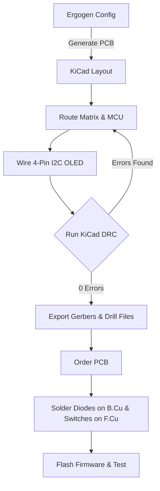

# solemn-v1.1

Just a cute lil keyboard that has 58 keys and some chill shapes! Onshape is: [Here](https://cad.onshape.com/documents/ffab3b96c6b14c6fbbbecfbc/w/70f0d4490e4bad1a7a011e3c/e/34635d68136bf4fd29bb578f?renderMode=0&uiState=6afcf95aaa4e5ee795028a4b)

